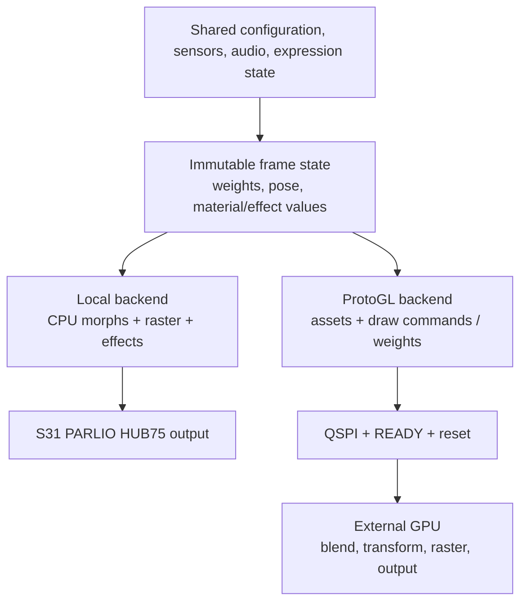

# ESP32-S31: single-chip and ProtoGL roadmaps

Plan date: 2026-10-08. This is the current implementation roadmap, replacing
the initial GPU-only recommendation in `esp32s31-protogl-architecture-plan.md`.
This request changes documentation only; it does not add a board environment,
port a display driver, flash hardware or implement the proposed GPU protocol.

## Two directions

| Path | Responsibilities | Main advantage | Constraint |
|---|---|---|---|
| A: S31 single chip | CPU animation, morph blend, renderer/effects; PARLIO HUB75 refresh | One processor, local framebuffer/preview, direct control of the complete pipeline | Geometry, morphs and panel buffers remain on the main chip; shared CPU/PSRAM bandwidth |
| B: general ProtoGL | Main CPU animation, audio, sensors/network; GPU renderer/display; optional resident morph blend | Lower main-side rendering memory/work; reusable host backend across CPU/display targets | QSPI, GPU capacities, resource lifetime and two firmware builds |

Plan to maintain both as separate build options. Path A does not depend on GPU firmware. Path B
host contracts and adapter work can proceed before the GPU source arrives;
physical rendering, memory allocation and GPU morph implementation wait for it.
Begin Path B on the existing S3 SDK to separate graphics integration from the
S31 SDK migration, then enable the same adapter on S31.



Detailed track plans:

- [Path A: S31 local renderer and PARLIO HUB75](esp32s31-parlio-roadmap.md).
- [Path B: general ProtoGL backend](protogl-backend-roadmap.md).
- [GPU morph resource/protocol design](gpu-morph-offload-plan.md).

## Evidence and pulled revisions

The application firmware baseline remains `5772870`; later commits on
`codex/esp32s31-protogl-plan` contain planning documents. The nested PAJ7620
working edits remain separate and must be preserved.

ProtoGL was pulled with `git pull --ff-only` in the ignored reference checkout:
`c099f90` -> **`5ce6fc290a73d3f6a81f14baaee4a6f0773f8196`**, master.
The update adds exact `SetClockMHz`, `QueryClockConfiguration` (Info9), nine
75/100/125/150/240/250/288/300/336 MHz profiles and strict descriptor/session
tests. Protocol remains **9**. Default boot remains 150 MHz; higher profiles
are opt-in. 336 MHz requires successful extended-mask negotiation; clock
requests and returned domain/setpoint information are not measured performance.
No resident morph-bank/weights blending API was added. Preserve that distinction
when scheduling the morph extension.

The updated library's existing link/session, boot-loader and round-trip tests
compiled under MSVC C++17 and PASS, including the new clock tests. This is a
host/HAL regression result, not a GPU firmware or physical QSPI qualification.

[Espressif's advanced HUB75 example](https://github.com/espressif/esp-idf/blob/master/examples/peripherals/parlio/parlio_tx/advanced_rgb_led_matrix/README.md)
lists S31 and continuous hardware refresh. Its sample packing is a basic color
demonstration; it is not proof of the project's 8-bit BCM/gamma/brightness parity.
[S31 PARLIO TX documentation](https://docs.espressif.com/projects/esp-idf/en/stable/esp32s31/api-reference/peripherals/parlio/parlio_tx.html)
supports the selected peripheral path. Pin the actual SDK and verify the
required looping and buffer-switch behavior in that revision.

The MIT [esphome-libs/esp-hub75](https://github.com/esphome-libs/esp-hub75)
reference was inspected at `d0bb571fdae6ec6215615de4b73a6e8ce8868a85`.
It has a substantial PARLIO/BCM backend but currently selects P4/C6, not S31.
It is a reuse/port candidate, not an already-supported S31 dependency.

The [Arduino 4/S31 PR](https://github.com/espressif/arduino-esp32/pull/12677)
is still shown as draft, while [pioarduino main](https://github.com/pioarduino/platform-espressif32)
advertises stable Arduino 3.3.12/IDF 5.5.5. Treat S31 build integration as a
separate gate. API documentation alone does not establish a working Arduino
application stack.

## Shared work before either production port

| ID | Work and files | Exit condition |
|---|---|---|
| C0 | Record the S3 scenario, asset hashes, geometry/color depth, expressions, OLED state and firmware flags; fix/pin PAJ7620 dependency packaging | A fresh checkout reproduces the baseline without an inaccessible gitlink or lost local edits |
| C1 | Separate CPU target, render backend and panel output selection in `main.cpp` / build configuration | Target selection no longer implies S3 HUB75 headers; invalid combinations fail clearly; existing S3 behavior builds unchanged |
| C2 | Introduce a small backend interface around `Controller::Render`, `Display`, brightness, media, preview and recovery | Local rendering and ProtoGL submission are explicit alternatives; GPU mode cannot accidentally call the local rasterizer |
| C3 | Separate animation state from geometry-dependent access in `JsonDrivenProtogenAnimation` | Names/IDs, stable weights, pose and material/effect values can be published without constructing GPU-unused `Object3D`/`TriangleGroup` buffers |
| C4 | Replace direct `_ae32` DSP calls in `Vector2D`/`Vector3D` with tested portable dispatch; audit microphone FFT/timer and allocation APIs | Both Xtensa and RISC-V builds use supported implementations with preserved math/audio behavior |
| C5 | Bound and publish frame state across tasks; repair media upload receive-buffer ownership | No mutation of accepted frame bytes, no shared packet race during file validation, no per-frame allocation in the new path |
| C6 | Separate timing and memory metrics from blocking console output | Reports include whole-frame wall time, actual presentation evidence and peak/steady heap categories |

Use a compile-time backend selection initially. A runtime backend switch would
require different asset allocations and quiescing both outputs; it is not a
prerequisite for either roadmap. Do not introduce a broad engine rewrite.

Illustrative interface responsibilities (names are provisional):

```text
Initialize(board/output configuration)
LoadAssets(asset source and metadata)
Submit(completed frame state) -> accepted / busy / error
Service(deadline) -> progress / completion / recovery status
SetBrightness / PresentMedia / GetPreviewCapabilities
Quiesce / Recover / Shutdown
```

Frame state is a bounded snapshot of weights, pose, draw visibility, material
parameters, camera and effect values. Local backends may still read published
geometry during the transition. Materials/effects are mutable today; vertex
copies alone do not permit safe render/animation overlap. Add snapshot fields
for enabled materials instead of sharing arbitrary live C++ object pointers.

## Build and release matrix

| Proposed environment | CPU/SDK | Backend | Dependency boundary |
|---|---|---|---|
| Existing S3 debug/release/profile | Current pinned/installed Arduino 3 / IDF 5 | Local S3 I2S DMA | Existing HUB75/USB patches |
| `esp32s3-protogl` experiment | Same working S3 SDK | ProtoGL | Pinned library; no S3 panel pack/driver allocation |
| `esp32s31-local` experiment | Verified S31 IDF 6.1-family / Arduino 4 combination | Local + PARLIO | Pinned S31-capable display port |
| `esp32s31-protogl` experiment | Same verified S31 combination | ProtoGL | Target-aware SPI/reset transport; no local panel dependency |

Names above are proposed, not environments created by this plan. If pioarduino
cannot package the required S31 SDK, start a small IDF project with the required
Arduino component rather than silently upgrading every S3 environment. Check
NetWizard, BLE, AsyncTCP/web server, LittleFS, M5GFX/M5Unified, ProtoGC, ESP-DSP,
microphone ADC/timer, token authentication and OTA before admitting a full build.
Keep C++17 or a compatible newer standard; preserve all existing S3 settings.

Create board/module pin maps from the actual S31 hardware, including flash/PSRAM,
USB, straps, mic, I2C/OLED, gesture, status LED and OTA button. Path A and Path B
have separate output pin maps; no P4/S3 example pins become S31 defaults.

Release manifests must distinguish CPU and backend (for example
`esp32s31-local` versus `esp32s31-protogl`) and, for Path B, matching GPU
protocol/build/asset schema. The current updater's S3/P4 manifest selection must
not offer a firmware image for the wrong wiring/backend. Preserve configured
asset authentication and token-gated OTA behavior. Version bumps happen during
release implementation, not documentation work.

## Measurement and acceptance policy

Planning assumption pending a preferred target: **60 unique presented frames/s
minimum**, with **90 and 120 FPS** as evaluated stretch points for the existing
two chained 64x32, 1/16-scan panels and 64x32 logical face. These are goals,
not forecasts. Use the current 495-vertex/523-triangle face plus worst supported
materials, speech/blink and media. Maintain the agreed 8-bit color/gamma and
brightness behavior when comparing routes; record any experimental lower-depth
mode separately.

| Goal | Frame interval | Meaning |
|---|---:|---|
| 60 FPS | 16.67 ms | Initial minimum under the agreed mixed workload |
| 90 FPS | 11.11 ms | Stretch benchmark; include update-to-present latency |
| 120 FPS | 8.33 ms | Stretch benchmark; reject inflated counters from repeated scans |

Panel scan refresh, submitted frame rate, rendered rate and unique presented
rate are different measurements. Use DMA buffer-switch events for Path A and
the actual supported completion fence for Path B. If the GPU backend stops at
Transferred rather than Displayed, label it and obtain external presentation
evidence before claiming displayed FPS.

Record p50/p95/p99 frame interval, maximum stall, input-to-presentation latency,
dropped/coalesced frames, scan refresh/underruns, mic blocks/drops and task stack
margins. Measure internal free/minimum/largest block and DMA allocations,
PSRAM steady/peak use, startup/asset-reload peaks, and GPU memory where present.
Do not interpret a combined PSRAM+SRAM PlatformIO percentage as internal headroom.
Use at least 20% internal free headroom after normal initialization as a
provisional target, plus a largest-block budget that fits measured peak service
allocations with margin. Freeze exact budgets after the first S31 baseline.

Gate parity with deterministic geometry/images and existing host checks; gate
hardware with a minimum two-hour mixed-workload run, then an overnight soak,
heap integrity, no unexplained corruption/reboots/audio regressions, BLE reconnect,
OLED sleep/wake, provisioning, asset refresh and authenticated OTA. OTA may pause
animation explicitly; display blanking/hold and resume policy must be tested.

## Execution order and dependencies

1. Complete C0-C2 and the portable math audit; capture a reliable S3 baseline.
2. Prepare the S31 SDK/board probe and Path A PARLIO driver feasibility separately.
3. Define Path B frame/material/asset contracts and prototype the S3 encoder
   against the existing library tests while GPU firmware is pending.
4. Complete Path A static panel, full-color output, local face and service parity.
5. When GPU source arrives, qualify Path B boot/QSPI/output and the host-vertex
   face; then implement the resident morph extension with matched revisions.
6. Move the proven ProtoGL adapter to S31 after its SDK/transport gate passes.
7. Compare both paths using the same presentation, memory and feature gates;
   tune only the measured bottleneck. Release them as separate supported builds.

Keep planning on `codex/esp32s31-protogl-plan`. Use separate later implementation
branches for shared backend work, S31/PARLIO and ProtoGL/morph integration so
one experimental SDK or driver does not destabilize the other path or `main`.
Future branch creation is an implementation step, not performed here.

## Information needed at the corresponding hardware gates

- Exact S31 board/module, PSRAM/flash variant and available GPIOs.
- Panel model/driver IC, scan wiring, chain orientation and desired color depth.
- Preferred FPS/latency target and acceptable preview behavior.
- Later: GPU source revision, build recipe, output profile, RAM/storage layout,
  pin map, and firmware identity/protocol/clock capability contract.

These do not prevent the present detailed plans or shared interface work. GPU
hardware success is deliberately left unclaimed until that source and hardware
are available.
