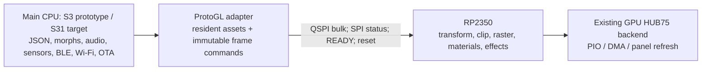

# ESP32-S31 and ProtoGL architecture review

Reviewed on 2026-10-08. Application baseline: `5772870` on `main`, following
`20b551c`. ProtoGL inspected through SSH at
`c099f90fe09e7d8db7b976048a8ab98905466642` (protocol 9).

## Decision

Proceed with a staged prototype of **main CPU + RP2350 graphics coprocessor**
over QSPI. Prove the adapter on ESP32-S3 first, then port the host to ESP32-S31.
Retain the current S3 local renderer and existing HUB75 library as a regression
baseline. The new host backend should use ProtoGL for rendering and panel output;
it does not need an ESP32-S31 HUB75 driver.

This is technically plausible, not yet a supported board configuration or a
measured performance claim. ProtoGL supplies the command encoder, runtime link,
SPI transport and boot loader, but explicitly defers the ProtoTracer application
adapter. Its GPU firmware and the actual panel must be qualified separately.

## Current changes: review and verification

The recent commits add S3 memory/render/material optimizations, OLED registration
and protection, bounded serial diagnostics, BLE projection, flash media playback
and the built-in playlist. Focused review covered the render/material changes,
output packing, media transport and the integration boundaries. It was not an
exhaustive audit of every subsystem or the native Android application.

Checks run on this checkout:

- `pio run -e esp32s3`: PASS, including factory/8 MB merged images, using
  installed Arduino 3.3.9/IDF 5.5.4 and the existing nested PAJ7620 edits.
  Existing SDK-config redefinition and deprecated API warnings remain.
- `host-tests/build_and_compare.cmd`: PASS, direct/legacy output byte-identical
  (6,144 bytes, FNV-1a `BE8B37A9`), grid/cache and audio checks pass.
- `host-tests/build_hub75.cmd`: PASS, 1,408 complete DMA comparison cases and
  bounded serial snapshot checks.
- `host-tests/build_materials.cmd`: PASS, 737,280 positions, palette lifetime,
  hue, virtual destruction and allocation failure checks.
- `host-tests/build_media.cmd`: PASS, four codecs and all 447 built-in frames.
- `host-tests/build_oled.cmd`: PASS, OLED policy and 288 exported QR fixtures.
  This invocation did not run a separate QR image decoding check.
- Browser media format/transport tests: all four Node tests PASS. Existing
  Chromium media UI test: PASS, including playlist, orientation, upload,
  playback, camera, language, phone layout and disconnect scenarios.
- ProtoGL's existing link/session, boot-loader and encoder round-trip tests:
  compiled with MSVC C++17 and PASS. Their fake HAL does not establish electrical
  SPI operation, GPU firmware correctness or rendering equivalence.

Review findings to resolve before broader concurrency:

1. **Media receive-buffer ownership (P2).** In `src/Media/MediaService.h`,
   `media.upload.end` calls `Validate(check)` while `acceptedKind` still permits
   file packets. `Validate` reads file data into the same `packet` buffer that
   the BLE callback writes in `Receive`. A late/repeated block during validation
   can corrupt the validation input. Disable ingress under `mux` and discard
   pending receive state before borrowing this buffer for file validation, or
   use a separate validation buffer. Add a controlled interleaving regression.
   Normal browser stop-and-wait behavior does not test this condition.
2. **Dependency reproducibility (P2).** The application tracks
   `lib/RevEng_PAJ7620` as gitlink `73f220a` without a `.gitmodules` file. Its
   working tree additionally changes I2C initialization and short-read handling.
   Those nested edits are outside the two application commits. Preserve them;
   package the reviewed fix and a resolvable dependency before claiming a fresh
   clone reproduces this device build. Do not commit an inaccessible gitlink.
3. The older October 4 optimization review describes the dynamic gradient
   lifetime fix as pending; `20b551c` already adds owned base colors and tests.
   Use the current code and measurements when prioritizing remaining work.

No firmware behavior is changed by this architecture plan. No S31 firmware,
RP2350 hardware test, Android build or device flash is claimed here.

## ESP32-S31 feasibility and SDK gate

[Espressif's datasheet](https://documentation.espressif.com/esp32-s31_datasheet_en.html)
describes dual 320 MHz RISC-V high-performance cores, FPUs, SIMD on one core,
512 KB HP SRAM, in-package DDR PSRAM, and general-purpose quad-capable SPI.
Its PPA/JPEG blocks are not evidence of a programmable 3D GPU compatible with
ProtoTracer materials. Treat RP2350 as the graphics processor for this design.

[Espressif's FAQ](https://esp32-s31.espressif.com/en/faq) places S31 support on
ESP-IDF master/v6.1 and identifies v6.1.1 onward as the official supported tag
path. The [feature status page](https://developer.espressif.com/hardware/esp32s31/)
still describes preview support; verify required peripherals against the exact
SDK revision rather than assuming that announcement equals application support.

The [Arduino S31 discussion](https://github.com/espressif/arduino-esp32/discussions/12692)
identifies Arduino 4/IDF 6.1 as the migration path, including BT/BLE API changes.
The [Arduino 4 support PR](https://github.com/espressif/arduino-esp32/pull/12677)
is relevant development evidence. The
[pioarduino main README](https://github.com/pioarduino/platform-espressif32)
currently advertises stable Arduino 3.3.12/IDF 5.5.5. None establishes that this
repository's existing Arduino 3 environment can compile for S31.

Before adding an S31 environment, pin and demonstrate a working compiler,
framework and board definition with serial, PSRAM, SPI DMA, I2C, ADC/audio,
LittleFS, Wi-Fi, BLE and OTA. Use an isolated IDF 6.1/Arduino 4 experiment if
the required pioarduino packaging is unavailable. Keep S3 on its present SDK.
Audit NetWizard, async web libraries, M5GFX, ProtoGC, FFT/DSP and authentication
dependencies against the selected SDK. Do not copy S3 SDK macros or GPIO pins.

ProtoGL's `PglSpiTransportEsp32::ValidPin` and
`PglBootUartEsp32::ValidPin` currently accept S3 GPIO0-21/26-48. They require
target-aware GPIO validation, output-capability checks and board pin exclusions
for S31. Audit SPI2/SPI3 host identifiers, DMA/cache alignment, UART and reset
handling under IDF 6.1 even where APIs appear source-compatible.

## Responsibilities and application integration

CPU retains configuration, face loading, half-float morph storage, expression
interpolation, visemes, blink/boop, sensor acquisition, remote protocols and
network startup ordering. Initially calculate morph vertices on the CPU and
send the resulting coordinates; GPU-side morph blending is a separate protocol
feature, not something established by the current vertex-update API.

Add a bounded render-backend seam for the local renderer and ProtoGL adapter.
`Controller::Render` currently calls `Camera::Rasterize` directly and is
nonvirtual; merely subclassing a controller and replacing `Display` would leave
CPU rasterization in place. GPU mode must bypass that path and screenspace CPU
effects deliberately. Guard S3 HUB75 dependencies, patch scripts, DMA debug
views and HUD globals by backend, not just CPU target.

Upload mesh/index/layout resources once, then issue vertex/material/camera
updates and draw commands. Current animation calls `Object3D::UpdateTransform`
before publishing vertices: initially send those world-space vertices and an
identity object transform. Sending them with their original object transform
would transform the face twice. Move object transforms to GPU only after
splitting morph-local coordinates from world-space publication and validating
the transform order, offsets, camera mapping and winding.

Map each active material, blend mode and screenspace effect explicitly to
ProtoGL. Reconstruct resources after a fresh session. Handle unsupported effects
through a documented local fallback or reject the configuration clearly.
Preserve the base-color/absolute-hue contract and the existing BLE op semantics.

The current logical face image is 64x32, mapped/mirrored onto two chained 64x32
panels. ProtoGL examples use 64x64: that example is not our wiring/layout.
Qualify chain order, orientation, scan ratio, brightness, gamma and color depth.
GPU frame output removes the CPU framebuffer used by the OLED preview; define
preview policy before removing it (optional local low-rate preview, or a future
bounded readback API). Raw framebuffer access is absent in protocol 9.

For media, keep PTM/BLE decoding initially and upload RGB565 textures/sprites.
Resident texture atlases can reduce per-frame traffic but must fit negotiated
GPU memory. Do not assume the built-in animation playlist fits in RP2350 RAM.

## QSPI contract and capacity

ProtoGL already implements the required quad data plane. Its bulk transaction
uses a **single-lane `0x81` command followed by four-lane payload**, selected
through `dataLanes=4` and D2/D3 wiring after capability negotiation. Control
(`0x80`) and 64-byte record reads (`0x00`) remain single-lane. This matches
[S31's SPI master quad-output mode](https://docs.espressif.com/projects/esp-idf/en/latest/esp32s31/api-reference/peripherals/spi_master.html).
Use GP-SPI, not the flash/PSRAM bus; do not turn the prefix into a quad command
or introduce DDR/octal transfers without a protocol change on both ends.

Wire SCK, CS, D0-D3, mandatory READY (RP GP22 in ProtoGL's reference), RUN/reset,
common ground and compatible logic voltage. Board-specific mapping must avoid
flash/PSRAM, boot straps, USB, microphone, OLED/I2C and OTA-button conflicts.
Do not reuse README example pins as an approved board pinout.

Start at ProtoGL's 1 MHz clock, then measure and qualify higher clocks. Respect
READY before every CS, the minimum 64-us CS gap, sessions, CRCs, exact retries,
frame credits and completion fences. READY is not frame credit. Keep command
buffers immutable until the exact DMA descriptor drains, including on timeout;
GPU resources also remain live until referencing work completes. Never retry
different bytes under the old sequence or reinterpret Accepted as Displayed.

The current face has **495 vertices and 523 triangles**. A full float32 XYZ
vertex update contains 5,940 coordinate bytes, about 356,400 B/s at 60 FPS,
before commands/control traffic. At 1 MHz this takes 47.52 ms single-lane or
11.88 ms quad, excluding overhead. At a hypothetical qualified 20 MHz quad it
takes 0.594 ms. These are wire-time estimates, not achieved frame rates; GPU
render/output time, READY stalls and single-lane status traffic must be measured.

The face's raw vertices plus uint16 triangle indices occupy 9,078 bytes before
mesh/envelope headers, exceeding ProtoGL's default 8,192-byte asset buffer.
Use bounded streamed mesh creation or a justified larger startup buffer below
the negotiated limit. The per-frame update fits the nominal 16,384-byte batch,
but validate the entire frame's commands and all objects before submission.
Sparse updates have 14 bytes per changed vertex rather than 12; they help only
when sufficiently few vertices change. Verify GPU semantics before treating
those records as additive morph deltas.

ProtoGL documents an RP2350 profile with 1,024 transformed vertices and 1,280
source/projected triangles, 64 meshes/materials, 16 textures and four shader
programs. The face alone fits nominal geometry limits; clipping expansion,
extra objects, materials, textures and shared scene heap still need admission
checks using actual `Capabilities`. Default host frame/asset buffers already
reserve 24 KB of internal DMA RAM; GPU offload does not eliminate host memory
pressure.

## Phases and acceptance gates

1. **Resolve and pin both repositories.** ProtoGL's inspected tree has
   `firmwares/rp2350` gitlink `7485d020b2bf1b71a42feefd4c12d5157ed92328`
   but no `.gitmodules` URL. Obtain its source/revision and build the matching
   protocol-9 HUB firmware. This review could inspect host code only. Resolve
   the PAJ7620 dependency and media ownership issue separately.
2. **S3 plus GPU smoke test.** Use FLASH_LOCAL initially, negotiate identity,
   capabilities and session; qualify READY/reset and one-lane CRC traffic at
   1 MHz, then quad payloads. Confirm panel configuration and an actual triangle
   on the intended chain. Failure must leave a bounded error/recovery path.
3. **Minimal face adapter.** Resident geometry, one solid material, fixed
   camera, CPU morph updates, world-space coordinates with identity object draw.
   Compare deterministic poses against the local backend. If GPU arithmetic or
   raster rules differ, record the differences and acceptance criteria; local
   byte-identical A/B tests do not certify the GPU renderer.
4. **Feature parity.** Add active materials/effects, absolute hue, media,
   brightness and preview policy. Exercise credit exhaustion, corrupted input,
   READY stuck low, reset/disconnect, timeout during DMA and full resource
   reconstruction. Assert no per-frame heap allocation or unbounded catch-up.
5. **S31 host port.** Only after the SDK gate, introduce a separate environment,
   target pin map and audited ProtoGL transport. Build the complete host and
   validate BLE/Wi-Fi transition, audio, OLED, provisioning and authenticated OTA.
6. **Measure and release.** Track frame encode/wire/render/present times,
   retries/errors, internal heap/largest block and GPU memory/metrics under a
   long mixed-workload soak. Retain S3 local support and pin host/GPU build IDs
   together; define upgrade compatibility and interrupted-update recovery.

New work belongs on `codex/esp32s31-protogl-plan` and later implementation
branches. `main` was already committed at `5772870`; `git push origin main`
confirmed it was up to date before the planning branch was created. This plan
does not add a speculative board environment or claim S31 support is complete.
